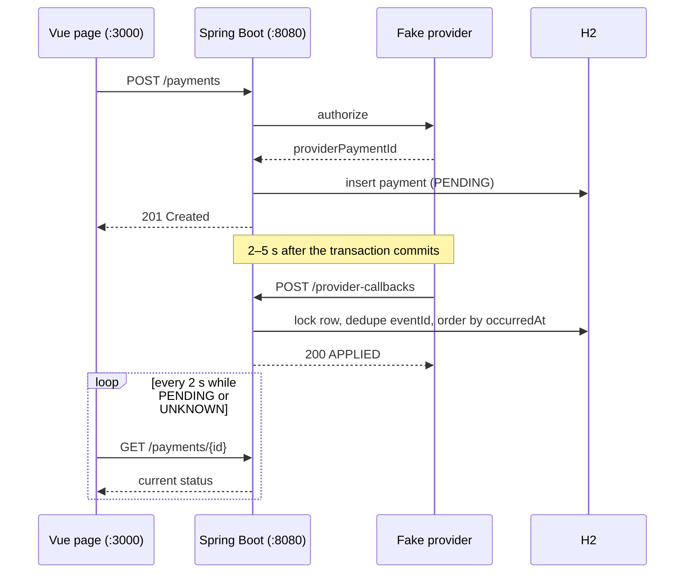

# Payment Inbox

A small operator app for card payments. The operator starts a payment; a fake provider accepts it
immediately and reports the outcome asynchronously through a callback. The operator follows the
status until it reaches a final state.

- **Backend**: Java 21, Spring Boot 3.3, Gradle wrapper, Spring Web, Spring Data JPA, H2 in-memory.
- **Frontend**: Vue 3 + TypeScript + Vite, one page, no UI library.
- Ports: backend **8080**, frontend **3000** (Vite proxies `/payments` to the backend).

## Screenshots

| Pending — polling every 2 s | Succeeded — polling stopped |
|---|---|
|  |  |


## How it works



## Requirements

- JDK 21 (`JAVA_HOME` set to it)
- Node.js 20+ with npm

Tested with Temurin 21.0.13+9, Gradle 8.10.2 (wrapper), Node 22.22.0, npm 10.9.4.

## Run

Backend:

```bash
cd backend
./gradlew bootRun
```

Frontend (in a second terminal):

```bash
cd frontend
npm install
npm run dev
```

Open <http://localhost:3000>. The first build needs Maven Central and npm once; runtime is fully
local and makes no external calls.

## Test

```bash
cd backend
./gradlew test
```

66 backend tests: payment API validation and contract, all callback rules (including equal
timestamps), the suppressed-callback decision proof, concurrency (two racing callbacks, duplicate
event ids), and two real-HTTP end-to-end tests of the fake provider. Frontend type-check and
production build:

```bash
cd frontend
npm run build
```

## Fake provider

The provider is a class in the backend (`provider/FakePaymentProvider`). It returns a
`prov-<uuid>` id immediately; after the payment transaction commits, it schedules a callback
2–5 seconds later and posts it over HTTP to `POST /provider-callbacks`.

Configure the reported outcome with environment variables (restart to apply):

```bash
APP_PROVIDER_OUTCOME=CAPTURED ./gradlew bootRun   # default -> payment SUCCEEDED
APP_PROVIDER_OUTCOME=DECLINED ./gradlew bootRun   # -> payment FAILED
APP_PROVIDER_OUTCOME=ERROR    ./gradlew bootRun   # -> payment UNKNOWN
APP_PROVIDER_OUTCOME=WHATEVER ./gradlew bootRun   # anything unrecognised -> payment UNKNOWN
```

Other knobs: `APP_PROVIDER_MIN_DELAY_MS` (default 2000), `APP_PROVIDER_MAX_DELAY_MS` (default
5000), `APP_PROVIDER_CALLBACK_URL` (default `http://localhost:8080/provider-callbacks`),
`APP_PROVIDER_AUTO_CALLBACK` (default `true`; tests switch it off).

## API

### `POST /payments`

```bash
curl -i -X POST http://localhost:8080/payments \
  -H 'Content-Type: application/json' \
  -d '{"amount": 12.50, "currency": "EUR", "customerReference": "ORDER-1001"}'
```

- `amount`: positive, at most 2 decimals (JSON number or numeric string, kept exact with `BigDecimal`)
- `currency`: exactly 3 letters, normalised to uppercase
- `customerReference`: non-blank, max 255 chars

`201 Created` with a `Location` header and:

```json
{
  "id": "d663626f-22e4-4316-9170-94d1dba57459",
  "status": "PENDING",
  "providerStatus": null,
  "providerPaymentId": "prov-01129ebf-f15e-4e51-a9c3-5418e735c299",
  "lastCallbackOccurredAt": null,
  "amount": 12.50,
  "currency": "EUR",
  "customerReference": "ORDER-1001"
}
```

Invalid payloads return `400`:

```json
{"error": "validation_failed", "message": "Request payload is invalid", "fieldErrors": {"amount": "must be greater than 0"}}
```

### `GET /payments/{id}`

Returns the same shape. `404` for an unknown id, `400` for a malformed id.

### `POST /provider-callbacks`

```bash
curl -i -X POST http://localhost:8080/provider-callbacks \
  -H 'Content-Type: application/json' \
  -d '{"eventId": "evt-1", "providerPaymentId": "prov-...", "status": "CAPTURED", "occurredAt": "2026-11-08T12:00:00Z"}'
```

- `200` with `{"result": "APPLIED" | "DUPLICATE" | "IGNORED" | "SUPPRESSED"}` — accepted even when
  the callback changes nothing.
- `404 unknown_provider_payment` when `providerPaymentId` is unknown (before dedupe, and not recorded).
- `400` for invalid payloads (`eventId`/`providerPaymentId` required, `occurredAt` required ISO-8601
  instant with offset, `status` optional).

Status mapping: `AUTHORIZED` → `PENDING`, `CAPTURED` → `SUCCEEDED`, `DECLINED` → `FAILED`,
everything else (including `null`) → `UNKNOWN`.

Rules: an `eventId` is applied once (globally); a callback with `occurredAt` equal to or older than
the last applied callback is ignored; `UNKNOWN` never replaces a known outcome, while a newer
`CAPTURED`/`DECLINED` may replace one. A suppressed callback changes no payment field — including
`lastCallbackOccurredAt` — but its `eventId` is still recorded. The reasoning, the counterexample,
and the other design decisions are in [NOTES.md](NOTES.md).

## Project structure

```
backend/   Spring Boot service, tests, Gradle wrapper
frontend/  Vue 3 + TypeScript page and polling composable
NOTES.md   Decisions, an AI mistake, production gaps
```

Backend packages: `api` (controllers, DTOs, error handling), `domain` (entities, repositories),
`service` (payment creation, callback rules), `provider` (fake provider, HTTP callback client).

H2 is in-memory: restarting the backend discards payments, and an in-flight fake callback dies with
the process. This is deliberate for a self-contained demo.
