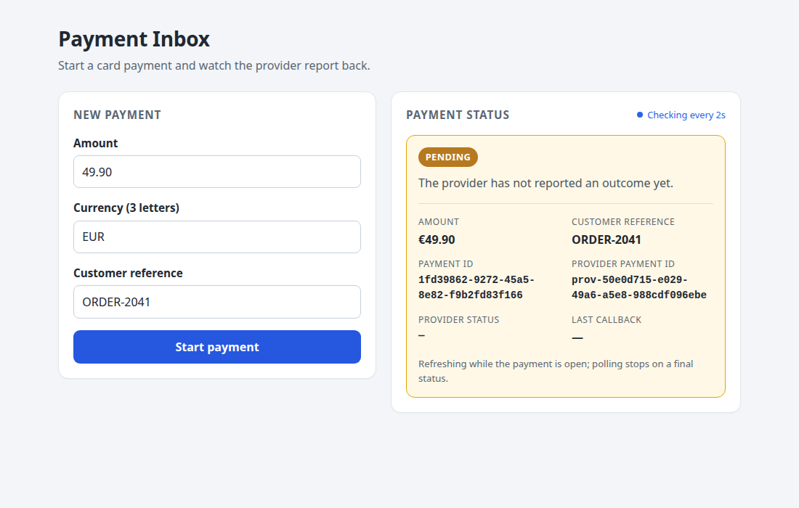
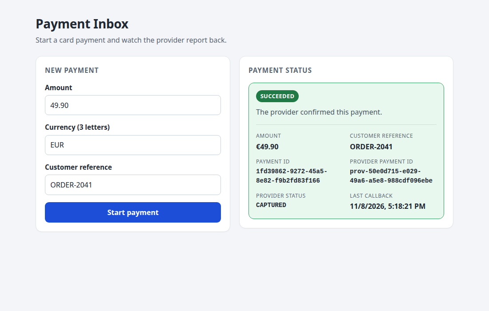
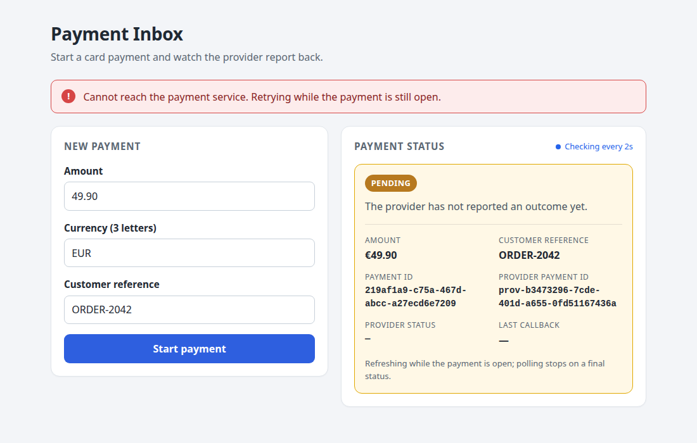
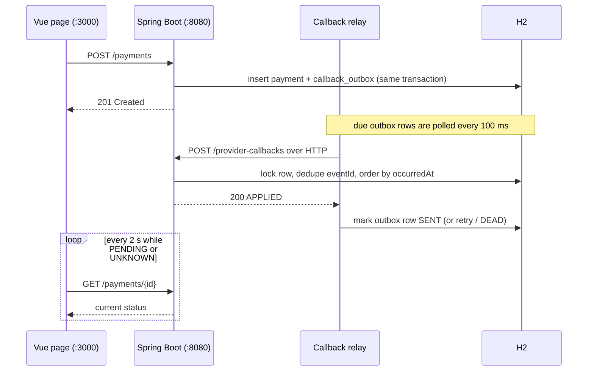

# Payment Inbox

[](https://github.com/TarouShota/payment-inbox-feg/actions/workflows/ci.yml)

A small operator app for card payments. The operator starts a payment; a fake provider accepts it
immediately and reports the outcome asynchronously through a callback. The operator follows the
status until it reaches a final state.

- **Backend**: Java 21, Spring Boot 3.3, Gradle wrapper, Spring Web, Spring Data JPA, H2 in-memory.
- **Frontend**: Vue 3 + TypeScript + Vite, one page, no UI library.
- Ports: backend **8080**, frontend **3000** (Vite proxies `/payments` to the backend).

## Screenshots

| Pending — polling every 2 s | Succeeded — polling stopped |
|---|---|
|  |  |



## How it works



## Security and consistency

- Money is `BigDecimal` end to end. Validation rejects zero, negative amounts, more than two
  decimals and malformed currencies; values are stored as `NUMERIC(19,2)`.
- Callback processing locks the payment row, deduplicates `eventId` in a global table, and only
  moves the `occurredAt` watermark when a callback is actually applied.
- The payment and its outbound callback are written in one transaction to a `callback_outbox`
  table. A relay sends due rows with bounded exponential backoff and parks a row as `DEAD` after
  the configured attempts, so a provider outage does not silently drop a callback.
- `Idempotency-Key` is a unique database column plus a request fingerprint, so concurrent retries
  cannot create two payments.
- Callback HMAC is optional and off by default to keep the assignment contract; when on it uses a
  timestamp window and constant-time comparison. No secrets are committed.
- Logs carry a generated or safe inbound `X-Request-Id`; customer references and secrets are not
  logged. In-memory H2 is demo-only — the production gaps are listed in [NOTES.md](NOTES.md).

## Requirements

- JDK 21 (`JAVA_HOME` set to it)
- Node.js 20+ with npm

Docker is optional. If you have it, Compose is the most reproducible path and does not need a local
JDK or Node install.

Tested with Temurin 21.0.13+9, Gradle 8.10.2 (wrapper), Node 22.22.0, npm 10.9.4, Docker 29.9.2
and Compose v5.6.1.

## Run with Docker

The Compose setup builds the backend with the committed Gradle wrapper, builds the page with Node
22, and serves it from nginx. Only Docker is required.

```bash
docker compose up --build
```

Open <http://localhost:3000>. The backend is also on <http://localhost:8080> (Swagger UI at
<http://localhost:8080/swagger-ui.html>). The frontend container proxies `/payments` to the
backend, so the browser does not need CORS. Stop it with `docker compose down`.

The provider outcome works the same way:

```bash
APP_PROVIDER_OUTCOME=DECLINED docker compose up --build
```

The backend container waits on its healthcheck before the frontend starts. H2 is still in memory,
so `docker compose down` discards payments and pending outbox rows.

## Run

Backend:

```bash
cd backend
./gradlew bootRun
```

Frontend (in a second terminal):

```bash
cd frontend
npm install
npm run dev
```

Open <http://localhost:3000>. The first build needs Maven Central and npm once; runtime is fully
local and makes no external calls. Create requests time out after 10 seconds, status polls after
8 seconds, and a failed create leaves the payment that was already being watched polling.

## Test

```bash
cd backend
./gradlew test
```

103 backend tests: payment API validation and contract, all callback rules (including equal
timestamps), the suppressed-callback decision proof, concurrency (two racing callbacks, duplicate
event ids, simultaneous idempotent creates), signed-callback authentication, outbox delivery,
retry backoff and dead-lettering, real-HTTP end-to-end tests of the fake provider, and the
generated OpenAPI document.

Five frontend tests cover the polling lifecycle: 2-second polling, stopping at a terminal status,
aborting the old request when a new payment starts, retrying after a network failure, and clearing
timers on unmount. Type-check and production build:

```bash
cd frontend
npm test
npm run build
```

Both suites run in GitHub Actions on every push to `main` and every pull request
(`.github/workflows/ci.yml`).

## API docs

With the backend running:

- Swagger UI: <http://localhost:8080/swagger-ui.html>
- OpenAPI JSON: <http://localhost:8080/v3/api-docs>

The schema is generated from the controllers and DTOs, so it stays in step with the code. It is
not a replacement for the behavioural tests above.

## Fake provider

The provider is a class in the backend (`provider/FakePaymentProvider`). It returns a
`prov-<uuid>` id immediately and writes the callback into `callback_outbox` in the payment
transaction. A scheduled relay delivers due rows over HTTP to `POST /provider-callbacks` after
2–5 seconds. A failed delivery retries with exponential backoff; after `APP_PROVIDER_MAX_ATTEMPTS`
it is parked as `DEAD` instead of retrying forever.

Configure the reported outcome with environment variables (restart to apply):

```bash
APP_PROVIDER_OUTCOME=CAPTURED ./gradlew bootRun   # default -> payment SUCCEEDED
APP_PROVIDER_OUTCOME=DECLINED ./gradlew bootRun   # -> payment FAILED
APP_PROVIDER_OUTCOME=ERROR    ./gradlew bootRun   # -> payment UNKNOWN
APP_PROVIDER_OUTCOME=WHATEVER ./gradlew bootRun   # anything unrecognised -> payment UNKNOWN
```

Other knobs: `APP_PROVIDER_MIN_DELAY_MS` (default 2000), `APP_PROVIDER_MAX_DELAY_MS` (default
5000), `APP_PROVIDER_CALLBACK_URL` (default `http://localhost:8080/provider-callbacks`),
`APP_PROVIDER_AUTO_CALLBACK` (default `true`; tests switch it off),
`APP_PROVIDER_CONNECT_TIMEOUT_MS` (default 2000), `APP_PROVIDER_READ_TIMEOUT_MS` (default 5000),
`APP_PROVIDER_RELAY_INTERVAL_MS` (default 100), `APP_PROVIDER_MAX_ATTEMPTS` (default 5),
`APP_PROVIDER_INITIAL_RETRY_MS` (default 500) and `APP_PROVIDER_MAX_RETRY_MS` (default 30000).
Callback timestamps further ahead than `APP_CALLBACK_MAX_FUTURE_SKEW` (default `5m`) are rejected
with `400`, so a bad provider clock cannot freeze the ordering watermark.

### Callback authentication (opt-in)

Callback auth is off by default so the assignment contract stays unchanged. Enable it with:

```bash
APP_CALLBACK_AUTH_ENABLED=true APP_CALLBACK_AUTH_SECRET="<shared secret>" ./gradlew bootRun
```

The fake provider signs automatically when auth is on. External callers must send:

- `X-Provider-Timestamp`: epoch seconds
- `X-Provider-Signature`: lowercase hex HMAC-SHA256 of `<timestamp>.<raw JSON body>`

The timestamp is part of the signed payload and must be within `APP_CALLBACK_AUTH_MAX_AGE`
(default `5m`) of the server clock, so a captured request cannot be replayed later. Signatures are
compared in constant time. Missing, tampered, or stale signatures get `401` with
`{"error":"invalid_signature"}` and are not recorded, so the same `eventId` can still arrive
correctly later.

```bash
TS=$(date +%s)
BODY='{"eventId":"evt-1","providerPaymentId":"prov-...","status":"CAPTURED","occurredAt":"2026-11-08T12:00:00Z"}'
SIG=$(printf '%s.%s' "$TS" "$BODY" | openssl dgst -sha256 -hmac "$APP_CALLBACK_AUTH_SECRET" -hex | sed 's/^.* //')
curl -i -X POST http://localhost:8080/provider-callbacks \
  -H 'Content-Type: application/json' \
  -H "X-Provider-Timestamp: $TS" \
  -H "X-Provider-Signature: $SIG" \
  -d "$BODY"
```

In production the secret would come from a secret manager and be rotated; this is a shared-secret
HMAC, not mTLS or per-provider key management. With auth enabled and a blank secret the service
refuses to start.

Every request gets an `X-Request-Id` header (incoming safe ids are reused, otherwise one is
generated) and each callback logs a single `callback outcome=...` line with the event id,
payment id and status transition. Customer references are not logged.

## API

### `POST /payments`

```bash
curl -i -X POST http://localhost:8080/payments \
  -H 'Content-Type: application/json' \
  -d '{"amount": 12.50, "currency": "EUR", "customerReference": "ORDER-1001"}'
```

- `amount`: positive, at most 2 decimals (JSON number or numeric string, kept exact with `BigDecimal`)
- `currency`: exactly 3 letters, normalised to uppercase
- `customerReference`: non-blank, max 255 chars
- optional `Idempotency-Key` header (1–128 safe characters)

Retries with the same `Idempotency-Key` and the same data return the original payment: `201`, the
same body and `Location`, plus `Idempotency-Replayed: true`. The provider is not called again.
Equivalent amount formatting (`10.0` vs `10.00`) and currency case count as the same request.
Reusing a key with different data returns `409 idempotency_key_reuse`; a malformed key returns
`400 invalid_idempotency_key`. Without the header, every request creates a payment. The unique key
column also settles two simultaneous first attempts: one creates, the other replays.

```bash
curl -i -X POST http://localhost:8080/payments \
  -H 'Content-Type: application/json' \
  -H 'Idempotency-Key: checkout-1042' \
  -d '{"amount": 12.50, "currency": "EUR", "customerReference": "ORDER-1001"}'
```

`201 Created` with a `Location` header and:

```json
{
  "id": "d663626f-22e4-4316-9170-94d1dba57459",
  "status": "PENDING",
  "providerStatus": null,
  "providerPaymentId": "prov-01129ebf-f15e-4e51-a9c3-5418e735c299",
  "lastCallbackOccurredAt": null,
  "amount": 12.50,
  "currency": "EUR",
  "customerReference": "ORDER-1001"
}
```

Invalid payloads return `400`:

```json
{"error": "validation_failed", "message": "Request payload is invalid", "fieldErrors": {"amount": "must be greater than 0"}}
```

### `GET /payments/{id}`

Returns the same shape. `404` for an unknown id, `400` for a malformed id.

### `POST /provider-callbacks`

```bash
curl -i -X POST http://localhost:8080/provider-callbacks \
  -H 'Content-Type: application/json' \
  -d '{"eventId": "evt-1", "providerPaymentId": "prov-...", "status": "CAPTURED", "occurredAt": "2026-11-08T12:00:00Z"}'
```

- `200` with `{"result": "APPLIED" | "DUPLICATE" | "IGNORED" | "SUPPRESSED"}` — accepted even when
  the callback changes nothing.
- `404 unknown_provider_payment` when `providerPaymentId` is unknown (before dedupe, and not recorded).
- `400` for invalid payloads (`eventId`/`providerPaymentId` required, `occurredAt` required ISO-8601
  instant with offset, `status` optional).

When `APP_CALLBACK_AUTH_ENABLED=true`, the same request must also carry
`X-Provider-Timestamp` and `X-Provider-Signature` (see above); otherwise it is rejected with
`401` before any payment lookup or event recording.

Status mapping: `AUTHORIZED` → `PENDING`, `CAPTURED` → `SUCCEEDED`, `DECLINED` → `FAILED`,
everything else (including `null`) → `UNKNOWN`.

Rules: an `eventId` is applied once (globally); a callback with `occurredAt` equal to or older than
the last applied callback is ignored; `UNKNOWN` never replaces a known outcome, while a newer
`CAPTURED`/`DECLINED` may replace one. A suppressed callback changes no payment field — including
`lastCallbackOccurredAt` — but its `eventId` is still recorded. The reasoning, the counterexample,
and the other design decisions are in [NOTES.md](NOTES.md).

## Project structure

```
.github/             CI workflow (backend tests, frontend build)
backend/             Spring Boot service, tests, Gradle wrapper, Dockerfile
frontend/            Vue 3 + TypeScript page, polling composable, nginx Dockerfile
docker-compose.yml   Backend + frontend containers on ports 8080 and 3000
NOTES.md             Decisions, an AI mistake, production gaps
```

Backend packages: `api` (controllers, DTOs, error handling), `config` (OpenAPI metadata),
`domain` (entities, repositories), `service` (payment creation, callback rules), `provider` (fake
provider, callback outbox and relay, HTTP callback client), `security` (optional callback HMAC
authentication).

H2 is in-memory: restarting the backend discards payments and any pending outbox rows. This is
deliberate for a self-contained demo.
